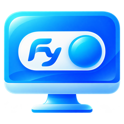
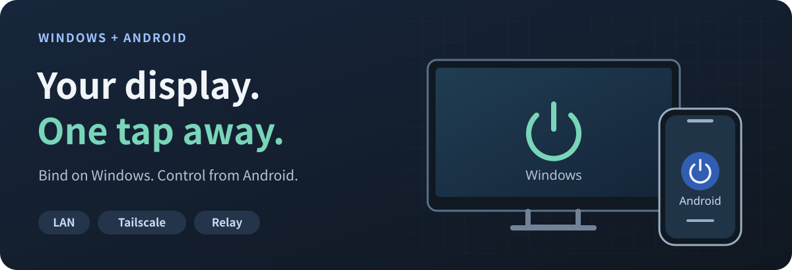
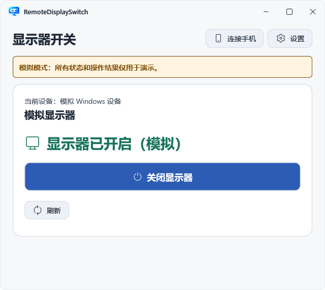
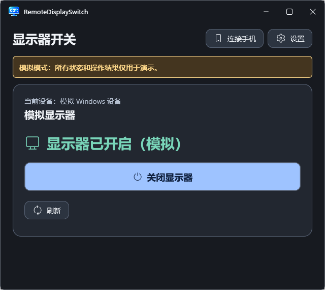

<p align="right">
  <a href="README.md">简体中文</a> | <strong>English</strong>
</p>

<p align="center">
  
</p>

<h1 align="center">Fy1Switch</h1>

<p align="center">
  <strong>Turn your Windows-connected monitor on and off from your phone.</strong><br>
  An Android app and Quick Settings tile, with direct LAN access and optional Tailscale or self-hosted relay connections.
</p>

<p align="center">
  
  
  
</p>

<p align="center">
  <a href="#quick-start">Quick start</a> | <a href="#preview">Preview</a> | <a href="#connections">Connections</a> | <a href="#build">Build from source</a> | <a href="#docs">Documentation</a>
</p>

<p align="center">
  
</p>

Fy1Switch brings your computer's monitor controls to your phone. Windows discovers, confirms, and controls the local target; Android provides everyday controls, status readings, and a system shortcut. It suits remote control of a desktop monitor, including setups with a virtual display. Check the compatibility notes below for your monitor and duplicate-display topology.

**This is a development preview.** No installer packages have been published as GitHub Releases. [Build from source](#build) to produce a self-contained Windows directory and an Android debug APK. See [compatibility and status](#compatibility) for the implemented features and local validation scope.

<a id="features"></a>

## What it does

| Feature | Experience |
| --- | --- |
| Monitor control from your phone | View status in the Android app and explicitly turn the target monitor on or off. |
| Quick Settings tile | Add the "远程显示器" tile to your panel. It toggles directly when the state is confirmed and reads the state first when it is unknown. |
| QR code and short-code pairing | Scan the computer's QR code, or discover it on the same LAN and enter the six-digit code shown on the computer. |
| Automatic connection selection | Try configured routes in order: LAN, Tailscale, then self-hosted Relay. |
| Automatic status readings | Perform bounded, read-only recovery when opening the home screen, returning to the foreground, or handling an uncertain result. |
| Optional background sync | Off by default. When enabled, a persistent notification accompanies periodic status readings and provides a stop action. |
| Windows system tray | Keep the app in the tray after closing its window, with status, refresh, and local monitor controls. |

<a id="preview"></a>

## Preview

These images use the actual WPF components rendered in an isolated simulation environment to show the current Windows interface and colors. Devices and states are simulated data, not results from physical monitor control. The current app interface is in Chinese.

<table>
  <tr>
    <th width="50%">Windows light theme</th>
    <th width="50%">Windows dark theme</th>
  </tr>
  <tr>
    <td></td>
    <td></td>
  </tr>
</table>

<a id="quick-start"></a>

## Quick start

You need a powered-on Windows x64 computer with a signed-in user, a phone running Android 10 or later, and a monitor that supports DDC/CI power control. Keep the phone and computer on the same LAN for initial pairing. If the monitor has a DDC/CI setting, enable it in the monitor's menu first.

### 1. Confirm the target monitor on your computer

Run `RemoteDisplaySwitch.Host.exe` from the complete Windows build directory, then discover and confirm your target in the interface. On first use, stay beside the monitor to verify that it turns off and back on before controlling it from your phone. Avoid running another DDC control program against the same monitor at the same time.

Keep the entire directory, including `worker/`, `cli/`, and dependency files. The self-contained package does not require a separate .NET or PowerToys installation. Run `Install.ps1` from the publish directory for a per-user installation; startup behavior is an opt-in setting.

### 2. Pair your phone

1. On Windows, open Settings ("设置"), enable Phone control ("手机控制"), check the detected LAN address, and save the connection settings.
2. Select Connect phone ("连接手机") and keep the QR code overlay open.
3. In the Android app, open Add computer ("添加电脑"), scan the computer's QR code, then review and confirm the pairing.
4. On the same LAN, you can also expand the nearby-computer entry, select the computer, and enter the six-digit code shown on its screen.

Pairing details expire after a short time and can only be used once. Each phone receives its own authorization, which can be revoked on Windows. If the address is unreachable, follow the [remote connection guide](docs/Remote-Control.md) to check the listener, firewall, and network isolation.

### 3. Use it day to day

- Open the Android home screen to view the current monitor state and use the main button to turn it on or off.
- Add the "远程显示器" tile in the system's Quick Settings editor. Long-press the tile to open the app.
- For background status updates, enable Sync monitor status in background ("后台同步显示器状态") in the device settings and grant notification permission when prompted. System battery-saving and background restrictions may affect syncing.
- To quit the Windows app, select Exit ("退出") in the tray menu. Closing the settings window leaves the app in the tray.

<a id="connections"></a>

## Connections

| Route | Use case | Requirements |
| --- | --- | --- |
| LAN HTTPS | Phone and computer are on the same network | Enable phone control on the computer and make sure the phone can reach the selected address and port. |
| Tailscale HTTPS | Connect while away from your home network | Install and configure Tailscale separately on both devices, then enable the corresponding route in Fy1Switch. |
| Self-hosted Relay | Use a relay as a connection route | Deploy a trusted Relay and configure the corresponding credentials separately on the computer and phone. |

Only configured routes are attempted. Network connection failures can trigger a route change; certificate and authorization errors are reported directly. Initial pairing uses a direct connection. Add Relay after pairing. This project does not automatically configure Tailscale, change firewall rules, or deploy a server.

Direct connections pin the computer's certificate, and each phone uses separate credentials. **Relay is a trusted intermediary with TLS on both connection legs. It can read forwarded content and does not provide end-to-end encryption that hides content from the relay.** See the [security and connection model](docs/Remote-Control.md) and [self-hosted Relay guide](docs/Relay.md).

<a id="compatibility"></a>

## Compatibility and status

| Area | Current scope |
| --- | --- |
| Windows | x64, running in a signed-in user session. The app cannot continue controlling the monitor when the computer is asleep or powered off. |
| Android | Android 10 / API 29 or later. The current client interface is in Chinese. Device manufacturers may restrict Quick Settings and background service behavior. |
| Monitor | Working DDC/CI power control and readback are required. Connection type, monitor firmware, and adapters affect compatibility. |
| Virtual displays and duplicate mode | Limited validation covers only a specific physical-monitor and VDD combination. Arbitrary VDD implementations or multiple-physical-monitor topologies are not guaranteed. |
| Release status | Windows, Android, and Relay are implemented and have local automated coverage. Android currently uses a debug build. |

Control is refused when the topology or target identity is uncertain. When an operation's outcome is unknown, the app queries the original operation and reads the current state. It does not blindly replay power commands or automatically replace the binding.

Local automation does not replace testing on real devices. Full-system restarts, sleep, physical unplugging, background and Quick Settings behavior on the target phone, and real LAN/Tailscale/Relay connections between devices still need validation using the relevant guides. See [P0 findings and validation](docs/P0-findings.md) for the confirmed scope of brief physical-monitor tests.

<a id="build"></a>

## Build from source

Use PowerShell 7 on Windows. The Windows build requires .NET SDK `10.0.400`, as specified in `global.json`, or a newer patch in the same feature band. The Android build requires Android SDK 36, JDK 17+, and Gradle 8.13. The validated local setup uses JDK 21.

```powershell
git clone https://github.com/Fy1ng/Fy1Switch.git
cd Fy1Switch

# Self-contained Windows directory
.\tools\Publish-Windows.ps1

# Android unit tests, lint, and debug APK
.\tools\Build-Android.ps1
```

| Output | Default location |
| --- | --- |
| Windows | `artifacts/windows/win-x64/RemoteDisplaySwitch.Host.exe` and dependencies in the same directory |
| Android | `src/android/app/build/outputs/apk/debug/app-debug.apk` |

The Android script defaults to `C:\android-sdk`, reads `JAVA_HOME`, and looks for a locally cached Gradle 8.13 installation. Use `-SdkPath`, `-JavaHome`, and `-GradlePath` for other locations. See the [Android build guide](docs/Android.md). The script does not automatically install the SDK or Gradle, or install the APK.

<details>
<summary>Development checks and directory layout</summary>

```powershell
.\tools\Test-Windows.ps1
.\tools\Test-Pairing.ps1
.\tools\Test-Network.ps1
```

Default tests use simulated monitors or local loopback services. Real-hardware diagnostics and explicit live fixtures have separate entry points. Read the relevant documentation before using them.

| Directory | Contents |
| --- | --- |
| `src/windows/` | Windows host, separate Worker, CLI, and control core |
| `src/android/` | Kotlin/Compose app and TileService |
| `src/relay/` | ASP.NET Core Relay and deployment inputs |
| `src/shared/` | Shared protocol contracts |
| `tests/` | Simulated and loopback automated tests |
| `vendor/` | PowerToys source subset pinned to a specific commit |

The repository is named Fy1Switch. Executable filenames, the Android package name, and runtime data directories retain `RemoteDisplaySwitch`. This README update does not change existing pairings or app identities.

</details>

<a id="docs"></a>

## Documentation

The detailed guides below are currently in Chinese.

| Topic | Guide |
| --- | --- |
| Windows installation, system tray, and local control | [Windows guide](docs/Windows-P1.md) |
| Networking, pairing, and security model | [Remote control](docs/Remote-Control.md) |
| Android app and Quick Settings | [Android usage and build](docs/Android.md) |
| Relay configuration and deployment | [Self-hosted Relay](docs/Relay.md) |
| Six-digit pairing protocol | [Pairing v1](docs/Pairing-v1.md) |
| Hardware validation scope | [P0 findings and validation](docs/P0-findings.md) |
| Development history and historical outputs | [Development and validation history](docs/Development-History.md) |

## Acknowledgments and third-party licenses

The monitor control core reuses a pinned source subset of Microsoft PowerToys Power Display and does not require PowerToys to be installed. Interface icons use Microsoft Fluent System Icons. The app icon uses the project's approved custom artwork.

See [THIRD-PARTY-NOTICES.md](THIRD-PARTY-NOTICES.md), the [PowerToys MIT license](vendor/powertoys/LICENSE), and [licenses/](licenses/) for third-party components and distribution requirements. Retain the dependencies and license files in the publish directory. The README's visual organization takes inspiration from [beautify-github-readme](https://github.com/oil-oil/beautify-github-readme); its hero SVG was created for this project.
