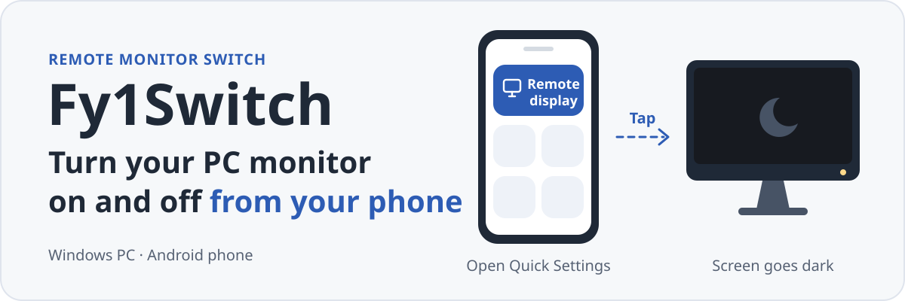

<p align="right"><a href="README.md">中文</a> · <b>English</b></p>

<p align="center">
  
</p>

<h1 align="center">Fy1Switch</h1>

<p align="center">
  <b>One tap on your phone turns your PC monitor off or back on.</b><br>
  An Android Quick Settings tile that connects over your LAN, Tailscale, or a self-hosted Relay.
</p>

<p align="center">
  
  
  
</p>

<p align="center">
  
</p>

<p align="center">
  <a href="#getting-started">Getting started</a> ·
  <a href="#how-it-works">How it works</a> ·
  <a href="#remote-access">Remote access</a> ·
  <a href="#known-limits">Known limits</a> ·
  <a href="#building-from-source">Building from source</a>
</p>

You're away from your desk and want the monitor off. Fy1Switch turns an Android phone into that monitor's power button. Tap the **Remote display** (远程显示器) tile in Quick Settings, and the Windows PC puts the monitor into standby (or wakes it) over DDC/CI, then reports the state it actually read back.

> [!NOTE]
> The Windows installer, portable ZIP, and Android APKs are on the [Releases](https://github.com/Fy1ng/Fy1Switch/releases/latest) page. For local Android testing, choose `android-optimized.apk`, signed with the local debug certificate for testing only. The `android-release-unsigned.apk` is unsigned and needs your signing key before installation or distribution. You can also [build from source](#building-from-source). Both apps currently have a Chinese-only interface; this README gives the original label next to each English name, for example **Settings** (设置).

## What it looks like

The Windows main window in light and dark themes. These are renders of the real WPF interface in simulation mode; the devices and states are test data.

<table>
  <tr>
    <td width="50%"></td>
    <td width="50%"></td>
  </tr>
</table>

## What you get

**On the phone**
- A home screen showing the monitor's last read-back state, with one button to turn it on or off.
- A **Remote display** (远程显示器) Quick Settings tile. When the state is known, a tap toggles it; when it isn't, the tile reads the state first. Long-press opens the app.
- Several PCs saved on one phone, with one picked as the default target.
- Optional background sync, off by default. When on, it shows a persistent notification and reads the state periodically.

**On the PC**
- A tray icon whose color tells you whether the monitor is on, off, or unknown.
- Brightness, contrast, volume, input source, color preset, and rotation controls, based on what the monitor reports it supports. Unsupported controls are greyed out, and each one can be hidden.
- A read-only view of the monitor's VCP capability list.
- A list of paired phones, each of which you can revoke on its own.

## Getting started

You need:

| | Requirement |
| --- | --- |
| PC | Windows x64, powered on and signed in. .NET Desktop Runtime 10.0 and ASP.NET Core Runtime 10.0 (x64) installed |
| Phone | Android 10 (API 29) or later |
| Monitor | DDC/CI power control. Some monitors need DDC/CI turned on in their on-screen menu first |

**1. Bind the monitor on the PC.** Download `setup.exe` from [Releases](https://github.com/Fy1ng/Fy1Switch/releases/latest) and install it for the current user (no admin rights needed), or extract `portable.zip` and run `Fy1Switch/Fy1Switch.Host.exe`. Then open **Settings** (设置). The app scans once for controllable monitors. Select yours and confirm the binding. Sit in front of the monitor and try one off-and-on cycle to make sure it controls the right screen. Don't run another DDC tool (such as PowerToys Power Display) against the same monitor at the same time; Fy1Switch detects this and refuses hardware access.

**2. Pair the phone.** Put the phone and the PC on the same local network. In the PC's main window, click **Connect phone** (连接手机) to show a QR code and a six-digit code. In the phone app, choose **Add computer** (添加电脑) and scan the QR code, or pick the PC from the nearby list and type the six-digit code. A pairing code is valid for 5 minutes and works once.

**3. Add the tile.** Edit your phone's Quick Settings panel and drag in **Remote display** (远程显示器). From then on you can switch the monitor without opening the app.

Closing the PC's main window only hides it to the tray. To quit, use **Exit** (退出) in the tray menu.

## How it works

```text
Android app / Quick Settings tile
        │  HTTPS, pinned PC certificate, per-phone credential
        ▼
Windows host (WPF, tray)
        │  private named pipe, process identity checked
        ▼
Hardware worker process ── DDC/CI ──▶ monitor  VCP D6: 0x04 for off, 0x01 for on
```

Design choices you'll notice in daily use:

- **The read-back decides.** A successful write only counts as "accepted". The app shows "confirmed" only when a fresh read of the power value matches the request. If the read fails, it shows "unconfirmed" and never treats an offline PC as "off".
- **No double toggles.** Each operation carries an operation ID. After a network timeout, the phone asks for that operation's result instead of sending the command again, and it keeps the same ID when it retries on another connection path.
- **It stops when the target changes.** Every read and write checks a fingerprint of the display topology. If the monitor was swapped or the target is no longer unique, the app refuses to act until you confirm the binding again on the PC.
- **Hardware calls run in isolation.** DDC calls run in a separate worker process with time limits. If one hangs, only the worker is cut off; the host keeps running.

The monitor control core is a subset of the Power Display source from [Microsoft PowerToys](https://github.com/microsoft/PowerToys), pinned to one commit and compiled into the project. You don't need PowerToys installed.

## Remote access

The phone tries the paths you have configured in this order and skips the rest:

| Order | Path | When to use it | What you set up |
| --- | --- | --- | --- |
| 1 | LAN HTTPS | At home, same network as the PC | Nothing; default port 48152 |
| 2 | Tailscale HTTPS | Away from home, Tailscale on both devices | Enable the Tailscale path in the PC's settings |
| 3 | Self-hosted Relay | Away from home without Tailscale | Run a Relay server you trust |

The phone moves to the next path only on connection failures such as no route or a timeout. Certificate, authorization, and protocol errors are shown directly instead of being hidden by a path switch.

Fy1Switch does not change your firewall, sign in to Tailscale, or deploy servers for you. If the phone can't reach the PC, start with the troubleshooting steps in [Remote control](docs/Remote-Control.md) (Chinese).

> [!WARNING]
> The Relay forwards traffic over two separate TLS legs, phone to Relay and Relay to PC. The Relay itself can read what it forwards; this is not end-to-end encryption. Only run it on a server you trust.

The Relay is an ASP.NET Core service with a Docker image and Compose files. Its web admin console supports password and passkey sign-in. Deployment steps are in [Self-hosted Relay](docs/Relay.md) (Chinese).

## Known limits

- **The PC must be awake.** Once the PC sleeps, shuts down, or signs out, the monitor can't be controlled. Wake-on-LAN is not provided.
- **Monitor support varies.** Firmware, cable type, adapters, and docks all affect DDC/CI. Some monitors report standby (0x02) after an "off" write; that is expected.
- **Complex setups have limited testing.** Hardware testing covered one physical monitor mirrored with one virtual display (VDD). Other multi-monitor or virtual-display combinations aren't guaranteed.
- **Phones may restrict background work.** Vendor battery policies affect the tile and background sync.
- **Some checks are still open.** Full reboot, resume from sleep, physical replugging, and real cross-network use still need hardware validation. What has been verified is recorded in the [P0 hardware findings](docs/P0-findings.md) (Chinese).

## Building from source

Run these in PowerShell 7 on Windows. Toolchain:

- Windows: .NET SDK 10.0.400 (see [`global.json`](global.json); newer patch versions are accepted)
- Android: Android SDK 36, JDK 17 or later, Gradle 8.13

```powershell
git clone https://github.com/Fy1ng/Fy1Switch.git
cd Fy1Switch

.\tools\Publish-Windows.ps1   # output: artifacts/windows/win-x64/
.\tools\Build-Android.ps1     # runs unit tests and lint, builds the debug APK
```

Keep the Windows output folder intact; its `worker/` and `cli/` subfolders are part of the app. Run `Install.ps1` from that folder to install for the current user (no admin rights needed). `Check-Runtime.ps1` checks that the required .NET runtimes are present.

<details>
<summary>More build options</summary>

```powershell
# Self-contained build with the .NET runtime bundled. Use a fresh output folder
.\tools\Publish-Windows.ps1 -SelfContained -OutputDirectory artifacts\windows\self-contained

# NSIS installer and portable ZIP; requires NSIS 3 installed locally
.\tools\Package-Windows.ps1 -MakeNsisPath 'C:\NSIS\makensis.exe'

# Optimized Android APK (R8 shrinking, signed with the local debug key)
.\tools\Build-Android.ps1 -Configuration Optimized -Clean

# When the SDK, JDK, or Gradle is not in its default location
.\tools\Build-Android.ps1 -SdkPath D:\android-sdk -JavaHome D:\jdk-21 -GradlePath D:\gradle-8.13\bin\gradle.bat
```

| Output | Location |
| --- | --- |
| Windows app | `artifacts/windows/win-x64/Fy1Switch.Host.exe` |
| Installer / portable ZIP | `artifacts/windows/packages/` |
| Android debug APK | `src/android/app/build/outputs/apk/debug/app-debug.apk` |
| Android optimized APK | `src/android/app/build/outputs/apk/optimized/app-optimized.apk` |

The test scripts `Test-Windows.ps1`, `Test-Pairing.ps1`, and `Test-Network.ps1` use simulated monitors and loopback networking by default and don't touch real hardware.

</details>

<details>
<summary>Repository layout</summary>

| Folder | Contents |
| --- | --- |
| `src/windows/` | WPF host, hardware worker, CLI, discovery, pairing, and remote-control modules |
| `src/android/` | Kotlin + Jetpack Compose app and the Quick Settings tile |
| `src/relay/` | ASP.NET Core Relay, Dockerfile, and Compose files |
| `src/shared/` | Protocol contracts shared by both ends |
| `tests/` | Unit tests and integration tests over loopback and simulated hardware |
| `tools/` | Build, packaging, install, and test scripts |
| `vendor/powertoys/` | Pinned subset of the PowerToys Power Display source |
| `docs/` | Detailed notes for each component |

</details>

## Documentation

Most documents are in Chinese; the pairing protocol is in English.

- [Windows guide](docs/Windows-P1.md): binding, state semantics, local CLI, install and uninstall
- [Android guide](docs/Android.md): app, tile, background sync, build
- [Remote control and pairing](docs/Remote-Control.md): connection paths, security model, network troubleshooting
- [Self-hosted Relay](docs/Relay.md): configuration, Docker deployment, reverse proxy
- [Six-digit pairing protocol](docs/Pairing-v1.md): SRP-6a handshake and wire format
- [P0 hardware findings](docs/P0-findings.md): what has been verified on real hardware
- [Development history](docs/Development-History.md)

## Credits and licenses

Monitor control is built on Power Display from Microsoft PowerToys (MIT; see [`vendor/powertoys/LICENSE`](vendor/powertoys/LICENSE)). Interface icons come from Microsoft Fluent System Icons. Other third-party components and their licenses are listed in [THIRD-PARTY-NOTICES.md](THIRD-PARTY-NOTICES.md) and the [`licenses/`](licenses/) folder. Include these license files whenever you distribute the app.
