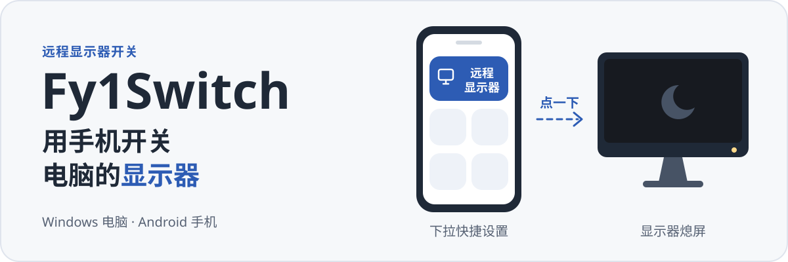

<p align="right"><b>中文</b> · <a href="README.en.md">English</a></p>

<p align="center">
  
</p>

<h1 align="center">Fy1Switch</h1>

<p align="center">
  <b>手机上点一下, 电脑显示器就熄屏或亮起.</b><br>
  Android 快捷设置开关, 支持局域网, Tailscale 和自建 Relay 三种连接方式.
</p>

<p align="center">
  
  
  
</p>

<p align="center">
  
</p>

<p align="center">
  <a href="#上手">上手</a> ·
  <a href="#工作方式">工作方式</a> ·
  <a href="#远程连接">远程连接</a> ·
  <a href="#已知边界">已知边界</a> ·
  <a href="#从源码构建">从源码构建</a>
</p>

人不在桌前, 也想关掉电脑那块显示器. Fy1Switch 让 Android 手机成为这块显示器的电源键: 在下拉快捷设置里点一下"远程显示器", Windows 电脑就通过 DDC/CI 让显示器进入待机或重新亮起, 再把读到的真实状态回报给手机.

> [!NOTE]
> Windows 安装包, 免安装 ZIP 和 Android APK 均可在 [Releases](https://github.com/Fy1ng/Fy1Switch/releases/latest) 下载. Android 本地测试请选 `android-optimized.apk`, 该包使用本机 debug 证书签名, 仅用于测试; `android-release-unsigned.apk` 未签名, 需要自行签名后才能安装或分发. 自行构建见[从源码构建](#从源码构建).

## 实际界面

Windows 端的主窗口, 浅色与深色主题. 截图由真实 WPF 界面在模拟模式下渲染, 设备和状态是测试数据.

<table>
  <tr>
    <td width="50%"></td>
    <td width="50%"></td>
  </tr>
</table>

## 你会用到的部分

**手机上**
- 主页显示目标显示器最近一次读回的状态, 一个按钮开或关.
- 快捷设置磁贴"远程显示器": 状态确定时直接切换, 不确定时先读取再说. 长按打开 App.
- 一部手机可以保存多台电脑, 选一台作默认目标.
- 后台同步默认关闭; 打开后会常驻一条通知, 定时读取状态.

**电脑上**
- 托盘常驻, 图标颜色区分开启, 关闭和未知.
- 按显示器实际报告的能力, 提供亮度, 对比度, 音量, 输入源, 色温和旋转调节, 不支持的项置灰. 每一项都可以隐藏.
- 只读查看显示器的 VCP 功能列表.
- 管理已配对的手机, 可以逐台撤销.

## 上手

需要准备:

| | 要求 |
| --- | --- |
| 电脑 | Windows x64, 保持开机并登录. 已安装 .NET Desktop Runtime 10.0 和 ASP.NET Core Runtime 10.0 (x64) |
| 手机 | Android 10 (API 29) 或更新 |
| 显示器 | 支持 DDC/CI 电源控制. 部分显示器需要先在 OSD 菜单里打开 DDC/CI |

**第一步, 在电脑上绑定显示器.** 从 [Releases](https://github.com/Fy1ng/Fy1Switch/releases/latest) 下载 `setup.exe` 安装 (当前用户, 无需管理员权限), 或解压 `portable.zip` 后运行 `Fy1Switch/Fy1Switch.Host.exe`. 启动后打开"设置", 程序会扫描一次可控制的显示器. 选中目标并确认绑定. 建议坐在显示器前试一次关闭和恢复, 确认控制的是这块屏. 同一时间不要让其他 DDC 工具 (例如 PowerToys 的 Power Display) 也在控制它, Fy1Switch 检测到会拒绝访问硬件.

**第二步, 配对手机.** 手机和电脑连到同一个局域网. 在电脑主窗口点"连接手机", 屏幕上会出现二维码和六位码. 在手机 App 里选"添加电脑", 扫码; 或者在附近设备列表里选中这台电脑, 输入六位码. 配对码 5 分钟内有效, 只能用一次.

**第三步, 把磁贴加到快捷设置.** 编辑手机的下拉快捷设置, 拖入"远程显示器". 以后不开 App 也能切换.

关闭电脑上的主窗口只会缩到托盘. 要彻底退出, 用托盘菜单里的"退出".

## 工作方式

```text
Android App / 快捷设置磁贴
        │  HTTPS, 固定电脑证书, 每台手机独立凭据
        ▼
Windows 宿主 (WPF, 托盘)
        │  私有命名管道, 校验进程身份
        ▼
硬件 Worker 进程 ── DDC/CI ──▶ 显示器  VCP D6: 关闭写 0x04, 开启写 0x01
```

几个影响使用体验的设计:

- **以读回为准.** 写入成功只算"已接受". 只有再次读回的电源值和请求一致, 才显示为已确认. 读不到就显示"未确认", 不把离线当作关闭.
- **不重复开关.** 每次操作带一个操作 ID. 网络超时后, 手机去查询这次操作的结果, 不会再发一次开关命令. 换连接路径重试时也沿用同一个 ID.
- **身份变了就停.** 每次读写都核对显示拓扑的指纹. 显示器被替换, 或目标不再唯一, 程序会拒绝控制, 要求回到电脑上重新确认绑定.
- **硬件访问隔离.** DDC 调用放在单独的 Worker 进程里, 有超时上限. 卡死时只隔离 Worker, 不拖垮主程序.

显示器控制核心来自 [Microsoft PowerToys](https://github.com/microsoft/PowerToys) Power Display 的源码子集, 固定在一个提交上, 随项目一起编译. 不需要另外安装 PowerToys.

## 远程连接

手机按下面的顺序尝试你配置过的路径, 没配置的跳过:

| 顺序 | 路径 | 什么时候用 | 你需要做的 |
| --- | --- | --- | --- |
| 1 | 局域网 HTTPS | 在家, 和电脑同一网络 | 无, 默认端口 48152 |
| 2 | Tailscale HTTPS | 在外面, 两端都装了 Tailscale | 在电脑设置里启用 Tailscale 路径 |
| 3 | 自建 Relay | 没有 Tailscale, 又需要在外面用 | 部署一台你信任的 Relay 服务器 |

只有连接层失败 (连不上, 超时) 才会换下一条路径. 证书, 授权或协议出错会直接报错, 不会被换路径掩盖.

Fy1Switch 不会替你修改防火墙, 登录 Tailscale 或部署服务器. 手机连不上电脑时, 先看[远程控制说明](docs/Remote-Control.md)里的排查步骤.

> [!WARNING]
> Relay 是两段 TLS 的转发服务, 手机到 Relay, Relay 到电脑各自加密. Relay 本身能看到转发的内容, 这不是端到端加密. 只部署在你信任的服务器上.

Relay 是一个 ASP.NET Core 服务, 提供 Docker 镜像和 Compose 文件, 管理界面支持密码和 Passkey 登录. 部署步骤见[自建 Relay](docs/Relay.md).

## 已知边界

- **电脑必须醒着.** 电脑睡眠, 关机或注销后, 无法再控制显示器. 项目不提供网络唤醒.
- **显示器兼容性因机而异.** 显示器固件, 接口类型, 转接头和扩展坞都会影响 DDC/CI. 写入"关闭"后, 有的显示器读回的是待机 (0x02), 这属于正常情况.
- **复杂拓扑只做过有限验证.** 实机测试覆盖的是一台实体显示器加一个虚拟显示器 (VDD) 的复制模式. 其他多屏或虚拟屏组合没有保证.
- **手机系统可能限制后台.** 磁贴和后台同步的表现受厂商省电策略影响.
- **未完成的验收.** 整机重启, 睡眠恢复, 物理拔插和真实跨网络场景还需要实机验证. 已验证的范围记录在 [P0 实机记录](docs/P0-findings.md).

## 从源码构建

在 Windows 上用 PowerShell 7 运行. 工具链要求:

- Windows 端: .NET SDK 10.0.400 (见 [`global.json`](global.json), 允许更新的补丁版本)
- Android 端: Android SDK 36, JDK 17 或更新, Gradle 8.13

```powershell
git clone https://github.com/Fy1ng/Fy1Switch.git
cd Fy1Switch

.\tools\Publish-Windows.ps1   # 输出 artifacts/windows/win-x64/
.\tools\Build-Android.ps1     # 运行单元测试和 lint, 生成 debug APK
```

Windows 发布目录要整体保留, 里面的 `worker/` 和 `cli/` 子目录是程序的一部分. 在该目录运行 `Install.ps1` 可以安装到当前用户 (不需要管理员权限); `Check-Runtime.ps1` 检查 .NET 运行时是否齐全.

<details>
<summary>更多构建选项</summary>

```powershell
# 自包含版本, 自带 .NET 运行时. 请用新的输出目录
.\tools\Publish-Windows.ps1 -SelfContained -OutputDirectory artifacts\windows\self-contained

# NSIS 安装包和免安装 ZIP, 需要本机已有 NSIS 3
.\tools\Package-Windows.ps1 -MakeNsisPath 'C:\NSIS\makensis.exe'

# Android 优化版 APK (R8 裁剪, 使用本机 debug 签名)
.\tools\Build-Android.ps1 -Configuration Optimized -Clean

# SDK, JDK, Gradle 不在默认位置时
.\tools\Build-Android.ps1 -SdkPath D:\android-sdk -JavaHome D:\jdk-21 -GradlePath D:\gradle-8.13\bin\gradle.bat
```

| 产物 | 位置 |
| --- | --- |
| Windows 程序 | `artifacts/windows/win-x64/Fy1Switch.Host.exe` |
| 安装包 / 免安装 ZIP | `artifacts/windows/packages/` |
| Android debug APK | `src/android/app/build/outputs/apk/debug/app-debug.apk` |
| Android 优化版 APK | `src/android/app/build/outputs/apk/optimized/app-optimized.apk` |

测试脚本 `Test-Windows.ps1`, `Test-Pairing.ps1`, `Test-Network.ps1` 默认使用模拟显示器和本机回环, 不会碰真实硬件.

</details>

<details>
<summary>仓库结构</summary>

| 目录 | 内容 |
| --- | --- |
| `src/windows/` | WPF 宿主, 硬件 Worker, CLI, 发现, 配对与远程控制模块 |
| `src/android/` | Kotlin + Jetpack Compose App 和快捷设置磁贴 |
| `src/relay/` | ASP.NET Core Relay, Dockerfile 与 Compose 文件 |
| `src/shared/` | 两端共用的协议定义 |
| `tests/` | 单元测试, 回环和模拟硬件的集成测试 |
| `tools/` | 构建, 打包, 安装和测试脚本 |
| `vendor/powertoys/` | 固定版本的 PowerToys Power Display 源码子集 |
| `docs/` | 各模块的详细说明 |

</details>

## 文档

- [Windows 使用说明](docs/Windows-P1.md): 绑定, 状态语义, 本地 CLI, 安装与卸载
- [Android 使用与构建](docs/Android.md): App, 磁贴, 后台同步
- [远程控制与配对](docs/Remote-Control.md): 连接路径, 安全模型, 网络排查
- [自建 Relay](docs/Relay.md): 配置, Docker 部署, 反向代理
- [六位码配对协议](docs/Pairing-v1.md): SRP-6a 握手与报文格式
- [P0 实机记录](docs/P0-findings.md): 已在真实硬件上验证过什么
- [开发记录](docs/Development-History.md)

## 致谢与许可

显示器控制基于 Microsoft PowerToys 的 Power Display (MIT, 许可见 [`vendor/powertoys/LICENSE`](vendor/powertoys/LICENSE)). 界面图标来自 Microsoft Fluent System Icons. 其余第三方组件及其许可列在 [THIRD-PARTY-NOTICES.md](THIRD-PARTY-NOTICES.md) 和 [`licenses/`](licenses/) 目录. 分发程序时请连同这些许可文件一起提供.
