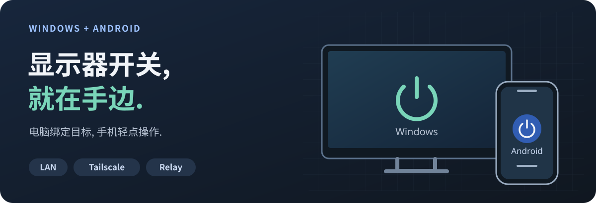

<p align="right">
  <strong>简体中文</strong> | <a href="README.en.md">English</a>
</p>

<p align="center">
  
</p>

<h1 align="center">Fy1Switch</h1>

<p align="center">
  <strong>用手机, 开关 Windows 电脑连接的显示器.</strong><br>
  Android App 与快捷设置开关, 局域网直连, 可选 Tailscale 和自建中继.
</p>

<p align="center">
  
  
  
</p>

<p align="center">
  <a href="#quick-start">快速开始</a> | <a href="#preview">界面预览</a> | <a href="#connections">连接方式</a> | <a href="#build">源码构建</a> | <a href="#docs">文档</a>
</p>

<p align="center">
  
</p>

Fy1Switch 将电脑端的显示器控制接入手机. Windows 负责发现, 确认和控制本地目标; Android 提供日常开关, 状态读取和系统快捷入口. 适合希望从手机操作桌面显示器, 或搭配虚拟显示器使用的场景. 显示器与复制拓扑的兼容性需按下方说明确认.

**当前为开发预览.** 仓库尚无 GitHub Release 安装包, 可按[源码构建](#build)生成 Windows 自包含目录和 Android debug APK. 已实现功能与本地测试范围见[兼容性与状态](#compatibility).

<a id="features"></a>

## 能做什么

| 功能 | 使用体验 |
| --- | --- |
| 手机开关显示器 | 在 Android App 中查看状态, 明确开启或关闭目标显示器. |
| 系统快捷设置 | 将"远程显示器"加入下拉面板, 已确认状态下直接切换, 状态不明时先读取. |
| 扫码与短码配对 | 扫描电脑二维码; 同一局域网内也可查找电脑并输入电脑显示的六位码. |
| 自动选择连接路径 | 按局域网, Tailscale, 自建 Relay 的顺序尝试已配置路径. |
| 自动读取状态 | 进入主页, 返回前台或遇到不确定结果时执行有界只读恢复. |
| 可选后台同步 | 默认关闭. 开启后显示常驻通知, 定期读取状态, 可从通知中停止. |
| Windows 托盘 | 主窗口关闭后留在托盘, 提供状态, 刷新和本地开关入口. |

<a id="preview"></a>

## 界面预览

下图使用真实 WPF 组件在隔离模拟环境中渲染, 展示当前 Windows 界面与配色. 图中的设备和状态均为模拟数据, 不代表实机控制结果.

<table>
  <tr>
    <th width="50%">Windows 浅色</th>
    <th width="50%">Windows 深色</th>
  </tr>
  <tr>
    <td></td>
    <td></td>
  </tr>
</table>

<a id="quick-start"></a>

## 快速开始

准备一台保持开机并登录的 Windows x64 电脑, 一部 Android 10 或更新的手机, 以及支持 DDC/CI 电源控制的显示器. 首次配对建议让手机和电脑处于同一局域网. 如显示器提供 DDC/CI 设置, 先在显示器菜单中开启.

### 1. 在电脑上确认目标显示器

从完整 Windows 构建目录运行 `Fy1Switch.Host.exe`, 在界面中发现并确认目标. 首次使用应在显示器旁核对实际开关与恢复, 再从手机操作. 使用时避免其他 DDC 控制程序同时访问同一显示器.

保留整个目录, 包括 `worker/`, `cli/` 和依赖文件. 自包含包不需要另外安装 .NET 或 PowerToys. 可从发布目录运行 `Install.ps1` 进行每用户安装; 自动启动由用户在设置中选择.

### 2. 配对手机

1. Windows 打开"设置", 启用"手机控制", 检查自动识别的局域网地址, 保存连接设置.
2. 点击"连接手机", 保持二维码浮层打开.
3. 在 Android App 中打开"添加电脑", 扫描电脑二维码, 核对并确认配对.
4. 同一局域网内也可展开附近电脑入口, 选择电脑并输入电脑屏幕上的六位码.

配对信息短时有效且只能使用一次. 每台手机获得独立授权, 可以在 Windows 端撤销. 地址无法访问时, 按[远程连接说明](docs/Remote-Control.md)检查监听, 防火墙和网络隔离.

### 3. 日常使用

- 打开 Android 主页查看当前显示器状态, 使用主按钮开启或关闭.
- 在系统快捷设置编辑页添加"远程显示器"; 长按开关可以打开应用.
- 需要后台状态更新时, 在设备设置开启"后台同步显示器状态"并按系统提示授权通知. 同步可能受系统省电和后台限制影响.
- 退出 Windows 程序请使用托盘菜单的"退出"; 关闭设置窗口会保留托盘.

<a id="connections"></a>

## 连接方式

| 路径 | 适用场景 | 需要准备 |
| --- | --- | --- |
| 局域网 HTTPS | 手机和电脑在同一网络 | 电脑启用手机控制, 手机能访问所选地址与端口. |
| Tailscale HTTPS | 离开家庭网络后连接 | 两端单独安装并配置 Tailscale, 在 Fy1Switch 中启用对应路径. |
| 自建 Relay | 需要中继作为连接路径 | 自行部署可信 Relay, 为电脑和手机分别配置对应凭据. |

只尝试已配置的路径. 网络连接失败可以切换路径, 证书和授权错误会直接提示. 首次配对走直连; 配对后再添加 Relay. 本项目不会自动配置 Tailscale, 修改防火墙或部署服务器.

直连固定校验电脑证书, 每台手机使用独立凭据. **Relay 是可信的两段 TLS 中继, 可以读取转发内容, 不提供对中继不可见的端到端加密.** 详见[安全与连接模型](docs/Remote-Control.md)和[自建 Relay](docs/Relay.md).

<a id="compatibility"></a>

## 兼容性与状态

| 项目 | 当前范围 |
| --- | --- |
| Windows | x64, 运行于已登录用户会话. 电脑睡眠或关机后无法由本应用继续控制显示器. |
| Android | Android 10 / API 29 起, 当前客户端界面为中文. 系统快捷设置和后台服务行为受设备厂商限制. |
| 显示器 | 需要可用的 DDC/CI 电源控制与读回. 连接方式, 显示器固件和转接设备会影响兼容性. |
| 虚拟显示器与复制模式 | 只对指定的实体屏与 VDD 组合做过受限验证, 不承诺任意 VDD 或多实体屏拓扑. |
| 发布状态 | Windows, Android 和 Relay 已实现并有本地自动化覆盖; Android 当前为 debug 构建. |

拓扑或目标身份不确定时拒绝控制. 操作结果不确定时查询原操作并读取状态, 不盲目重放开关命令或自动更换绑定.

本地自动化不替代实机验收. 整机重启, 睡眠, 物理拔插, 目标手机的后台与快捷设置行为, 以及真实 LAN/Tailscale/Relay 跨设备场景仍需按各专题文档验证. 已确认的短时实体屏测试范围见 [P0 发现与验证](docs/P0-findings.md).

<a id="build"></a>

## 源码构建

在 Windows 上使用 PowerShell 7. Windows 构建需要 `global.json` 指定的 .NET SDK `10.0.400` 或同 feature band 的更新补丁. Android 构建需要 Android SDK 36, JDK 17+ 和 Gradle 8.13; 已验证的本地组合使用 JDK 21.

```powershell
git clone https://github.com/Fy1ng/Fy1Switch.git
cd Fy1Switch

# Windows 自包含目录
.\tools\Publish-Windows.ps1

# Android 单测, lint 和 debug APK
.\tools\Build-Android.ps1
```

| 产物 | 默认位置 |
| --- | --- |
| Windows | `artifacts/windows/win-x64/Fy1Switch.Host.exe` 及同目录依赖 |
| Android | `src/android/app/build/outputs/apk/debug/app-debug.apk` |

Android 脚本默认使用 `C:\android-sdk`, 读取 `JAVA_HOME`, 并查找本机缓存的 Gradle 8.13. 其他安装位置请使用 `-SdkPath`, `-JavaHome`, `-GradlePath` 指定, 详见 [Android 构建说明](docs/Android.md). 脚本不自动安装 SDK 或 Gradle, 不安装 APK.

<details>
<summary>开发验证与目录说明</summary>

```powershell
.\tools\Test-Windows.ps1
.\tools\Test-Pairing.ps1
.\tools\Test-Network.ps1
```

默认测试使用模拟显示器或本机回环服务. 真实硬件诊断与显式 live fixture 有独立入口, 请先阅读对应文档.

| 目录 | 内容 |
| --- | --- |
| `src/windows/` | Windows 宿主, 独立 Worker, CLI 与控制核心 |
| `src/android/` | Kotlin/Compose App 与 TileService |
| `src/relay/` | ASP.NET Core Relay 与部署输入 |
| `src/shared/` | 共享协议契约 |
| `tests/` | 模拟与回环自动化测试 |
| `vendor/` | 固定提交的 PowerToys 源码子集 |

项目现已完整更名为 Fy1Switch, 包括程序文件名, Android 包名 `com.fy1ng.fy1switch`, Windows 数据目录及配对身份. 新版与更名前的旧版使用独立身份, 需要重新绑定显示器和配对手机; 旧版数据保留, 不自动迁移. 请退出旧版后使用新版, 并重新添加新版的 Android 快捷设置开关.

</details>

<a id="docs"></a>

## 文档

| 主题 | 文档 |
| --- | --- |
| Windows 安装, 托盘与本地控制 | [Windows 使用说明](docs/Windows-P1.md) |
| 网络, 配对与安全模型 | [远程控制](docs/Remote-Control.md) |
| Android App 与快捷设置 | [Android 使用与构建](docs/Android.md) |
| 中继配置与部署 | [自建 Relay](docs/Relay.md) |
| 六位短码协议 | [Pairing v1](docs/Pairing-v1.md) |
| 硬件验证范围 | [P0 发现与验证](docs/P0-findings.md) |
| 开发过程与历史产物 | [开发与验证记录](docs/Development-History.md) |

## 致谢与第三方许可

显示器控制核心复用 Microsoft PowerToys Power Display 的固定源码子集, 不要求安装 PowerToys. 界面图标使用 Microsoft Fluent System Icons, 应用图标使用项目已确认的独立素材.

第三方组件及分发要求见 [THIRD-PARTY-NOTICES.md](THIRD-PARTY-NOTICES.md), [PowerToys MIT 许可证](vendor/powertoys/LICENSE)与 [licenses/](licenses/). 保留发布目录内的依赖和许可证文件. README 视觉组织参考 [beautify-github-readme](https://github.com/oil-oil/beautify-github-readme), 首屏 SVG 为本项目制作.
